# Surveillance de réseau et détection de comportements anormaux avec des systèmes de journalisation (SIEM) — ELK Stack + Suricata

**Projet tuteuré INF 1522** — Licence Professionnelle, Systèmes et Réseaux Informatiques
École Polytechnique de Lomé — Université de Lomé — Année universitaire 2024-2025

**Enseignant tuteur :** Dr. BARATE Mohamed
**Étudiants :** GNRONFOU Koffi Jean Magloire · AKAMA Kodjovi Jean-Hugues

---

## Sommaire

1. [Présentation du projet](#présentation-du-projet)
2. [Objectifs](#objectifs)
3. [Qu'est-ce qu'un SIEM ?](#quest-ce-quun-siem-)
4. [Solutions SIEM comparées](#solutions-siem-comparées)
5. [Solution retenue : ELK Stack + Suricata](#solution-retenue--elk-stack--suricata)
6. [Attaques couvertes](#attaques-couvertes)
7. [Architecture du projet](#architecture-du-projet)
8. [Équipements et prérequis](#équipements-et-prérequis)
9. [Installation et configuration](#installation-et-configuration)
10. [Règles de détection Suricata](#règles-de-détection-suricata)
11. [Agent de collecte Windows : Winlogbeat](#agent-de-collecte-windows--winlogbeat)
12. [Scénarios de test et résultats](#scénarios-de-test-et-résultats)
13. [Conclusion](#conclusion)
14. [Références](#références)

---

## Présentation du projet

Ce projet met en place une solution **SIEM (Security Information and Event Management)** open-source basée sur la combinaison **ELK Stack** (Elasticsearch, Logstash, Kibana) et **Suricata** (IDS/IPS), afin de surveiller en temps réel le trafic d'un réseau local, centraliser les journaux (logs) et détecter des comportements anormaux ou malveillants.

Trois attaques réelles sont simulées pour évaluer l'efficacité du système déployé :
- une attaque par **déni de service (DoS)**,
- une attaque **SSH par force brute**,
- une tentative d'**authentification illégitime** sur un poste Windows.

## Objectifs

### Objectif général

Développer et déployer une solution de surveillance de réseau capable de détecter et d'analyser les comportements anormaux, avec journalisation, analyse en temps réel et réponse rapide aux incidents de sécurité.

### Objectifs spécifiques

- Déployer un environnement de travail virtualisé simulant un réseau d'entreprise.
- Installer et configurer la solution SIEM choisie.
- Collecter les logs de manière centralisée via des agents installés sur les équipements du réseau.
- Simuler des attaques pour évaluer l'efficacité du système déployé.

### Résultats attendus

Le système SIEM déployé doit être capable de :
- collecter et centraliser en temps réel les logs de tous les équipements du réseau ;
- normaliser les données collectées ;
- corréler les événements pour détecter anomalies et indicateurs de compromission ;
- détecter efficacement les tentatives d'intrusion et les attaques DoS ;
- fournir des alertes et des tableaux de bord pour une intervention rapide.

## Qu'est-ce qu'un SIEM ?

Un **SIEM (Security Information and Event Management)** est une solution de gestion de la sécurité des systèmes d'information qui collecte, analyse, corrèle et stocke les données générées par les événements de sécurité d'un réseau. Il combine deux composants :

| Composant | Rôle |
|---|---|
| **SEM** (Security Event Management) | Collecte et stockage des logs générés par les équipements du réseau (serveurs, pare-feux, routeurs…) |
| **SIM** (Security Information Management) | Analyse de ces événements, recherche d'anomalies, génération d'alertes |

### Fonctionnalités clés

- Collecte et gestion centralisée des logs
- Normalisation des événements
- Corrélation d'événements en temps réel
- Alertes et notifications
- Analyse forensique (post-incident)
- Tableaux de bord personnalisés
- Automatisation de la réponse aux incidents

### Limites

- Complexité de mise en place (compétences techniques, investissement initial)
- Génération possible de faux positifs
- Coût élevé, notamment pour les solutions sur site

## Solutions SIEM comparées

| Solution | Type | Points forts | Limites |
|---|---|---|---|
| <br>**AlienVault OSSIM** | Open-source | Abordable, populaire chez les PME | Moins riche en fonctionnalités que les versions commerciales |
| 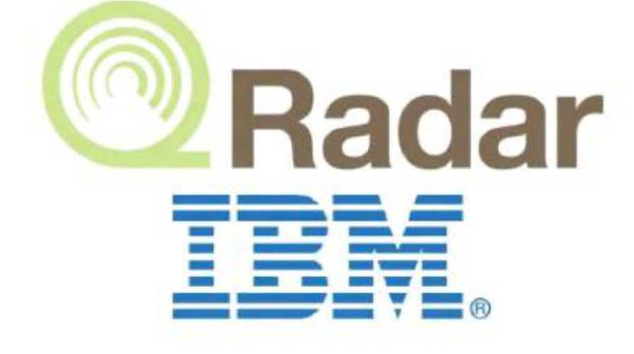<br>**IBM QRadar** | Commercial | Large choix de cas prédéfinis, collecte de logs/flux Cloud | Coût élevé, personnalisation complexe, peut générer des notifications non critiques |
| 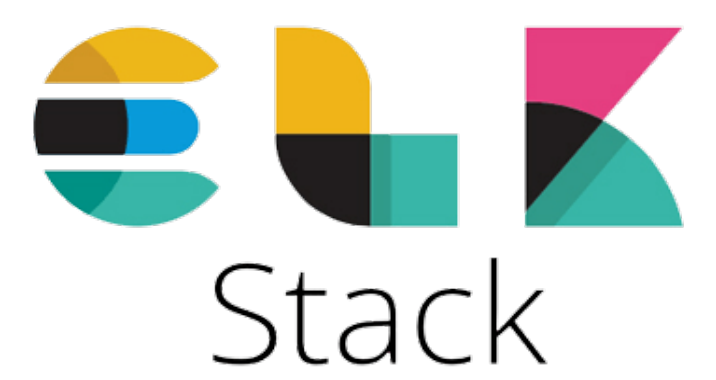<br>**ELK Stack + Suricata** | Open-source | Flexible, gratuit, interface Kibana conviviale, recherche en temps réel performante | Nécessite un IDS/IPS complémentaire (Suricata) pour couvrir pleinement les fonctionnalités SIEM |

C'est la combinaison **ELK Stack + Suricata** qui a été retenue pour ce projet, en raison de sa flexibilité, sa gratuité et sa facilité d'utilisation.

## Solution retenue : ELK Stack + Suricata

### ELK Stack

ELK Stack est une suite d'outils open-source développée par **Elastic**, composée de trois briques :

| Outil | Rôle |
|---|---|
| **Elasticsearch** | Moteur de recherche et d'indexation : stocke et analyse les logs |
| **Logstash** | Collecteur de logs : récupère, filtre et transforme les données avant envoi vers Elasticsearch |
| **Kibana** | Interface graphique de visualisation sous forme de tableaux de bord interactifs |

<p align="center">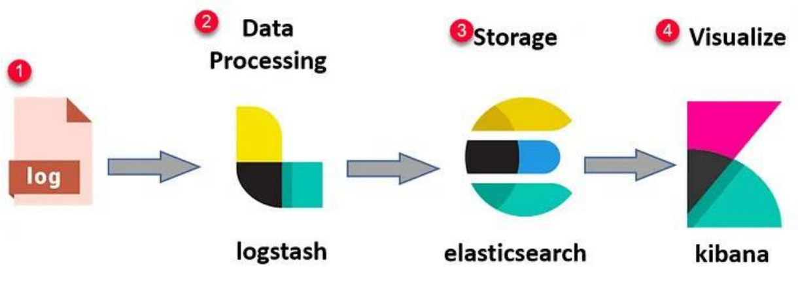<br><em>Figure 4 — Processus de fonctionnement de la structure ELK Stack</em></p>

### Suricata

Suricata est un moteur de détection/prévention d'intrusion (**IDS/IPS**) open-source, performant et multi-thread, qui analyse le trafic réseau en profondeur (IP, DNS, HTTP, TLS…) et génère des alertes détaillées.

**Fonctionnement :**
1. Capture des paquets depuis une interface réseau ou un trafic pré-enregistré.
2. Réassemblage des paquets en flux via un moteur de threads (chaque paquet traité par un thread dédié).
3. Comparaison des signatures des paquets aux règles de détection prédéfinies.
4. Génération de journaux indiquant les paquets acceptés ou rejetés.

<p align="center">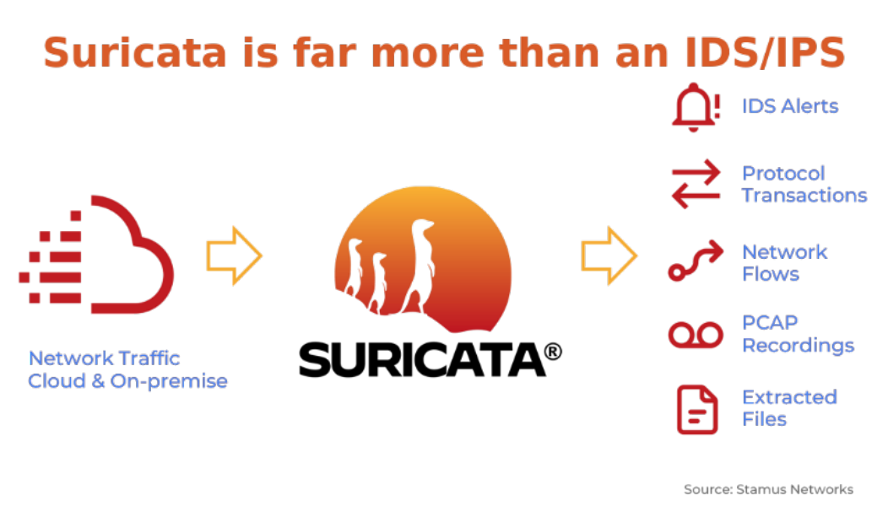<br><em>Figure 5 — Diagramme de fonctionnement de Suricata</em></p>

L'association **ELK Stack + Suricata** permet de couvrir pleinement les fonctionnalités caractéristiques d'un SIEM : détection d'intrusions, corrélation d'événements et analyse centralisée de la sécurité réseau.

## Attaques couvertes

Le projet présente les principales familles d'attaques de cybersécurité, dont deux sont simulées en pratique :

| Attaque | Description |
|---|---|
| **Injection SQL** | Insertion de code malveillant dans des requêtes SQL via des formulaires ou entrées non sécurisées |
| **Déni de service (DoS / DDoS)** | Surcharge d'un service par des requêtes excessives ; variante distribuée (DDoS) lancée depuis un botnet |
| **Homme du milieu (MITM)** | Interception/modification de communications entre deux parties à leur insu |
| **Force brute** | Tentatives répétées de deviner un mot de passe ou une clé |
| **Malware** | Virus, cheval de Troie, ransomware |

Les attaques **simulées** dans ce projet sont le **DoS** (via `hping3`) et la **force brute SSH** (via `Hydra`), complétées par un test d'**authentification illégitime** sur un poste Windows.

## Architecture du projet

<p align="center">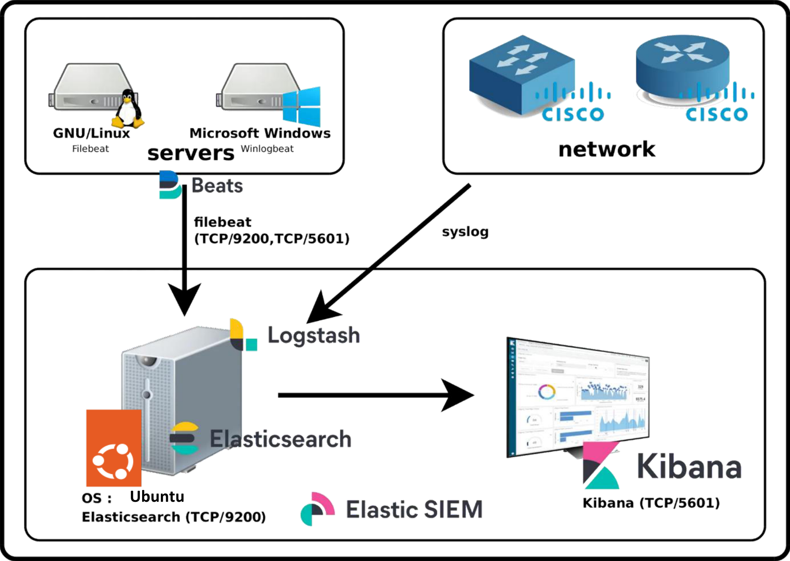<br><em>Figure 7 — Architecture du projet</em></p>

L'architecture repose sur un réseau segmenté en trois zones :

- **Servers** : serveurs GNU/Linux (agent **Filebeat**) et Microsoft Windows (agent **Winlogbeat**), qui envoient leurs logs via les **Beats** (ports TCP 9200 / 5601).
- **Network** : équipements réseau Cisco, qui transmettent leurs journaux via **syslog**.
- **Serveur ELK** (sous Ubuntu) : reçoit les flux via **Logstash**, les indexe dans **Elasticsearch** (TCP 9200), et les expose dans **Kibana** (TCP 5601) sous forme de tableaux de bord **Elastic SIEM**.

## Équipements et prérequis

| Équipement | Rôle |
|---|---|
| **Hyperviseur VMware** | Gestionnaire de machines virtuelles, permet la mise en réseau de plusieurs VM |
| **Serveur Ubuntu** | Héberge le SIEM ELK Stack + Suricata ; centralise les logs du réseau |
| **Client Windows** | Machine cible attaquée ; logs collectés par Logstash via Winlogbeat |
| **Machine attaquante Kali Linux** | Origine des attaques simulées (brute force, DoS) |
| **Application Telegram** | Canal d'alerte instantanée en cas d'attaque détectée |

<p align="center"></p>

## Installation et configuration

### 1. Mise à jour du système (Debian/Ubuntu)

<p align="center">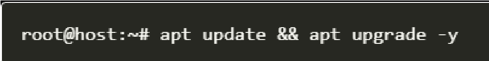<br><em>Figure 8 — Mise à jour et mise à niveau du système</em></p>

### 2. Installation d'Elasticsearch

<p align="center">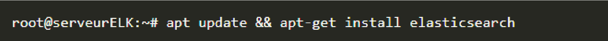<br><em>Figure 9 — Commande d'installation d'Elasticsearch</em></p>

### 3. Installation de Kibana

<p align="center">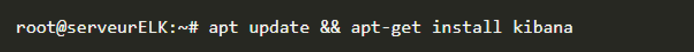<br><em>Figure 10 — Commande d'installation de Kibana</em></p>

### 4. Configuration de l'interface d'écoute d'Elasticsearch

Éditer le fichier `/etc/elasticsearch/elasticsearch.yml` :

<p align="center">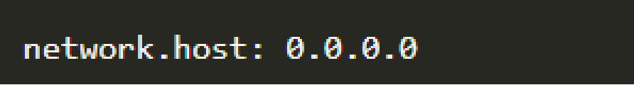<br><em>Figure 11 — Configuration de l'interface d'écoute (network.host)</em></p>

### 5. Démarrage du service Elasticsearch

<p align="center">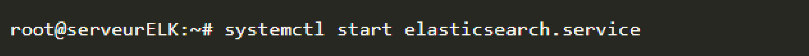<br><em>Figure 12 — Démarrage du service Elasticsearch</em></p>

Une fois le service démarré, le tableau de bord Kibana est accessible via une connexion sécurisée à l'adresse `https://<IP-du-serveur>:5601`.

<p align="center">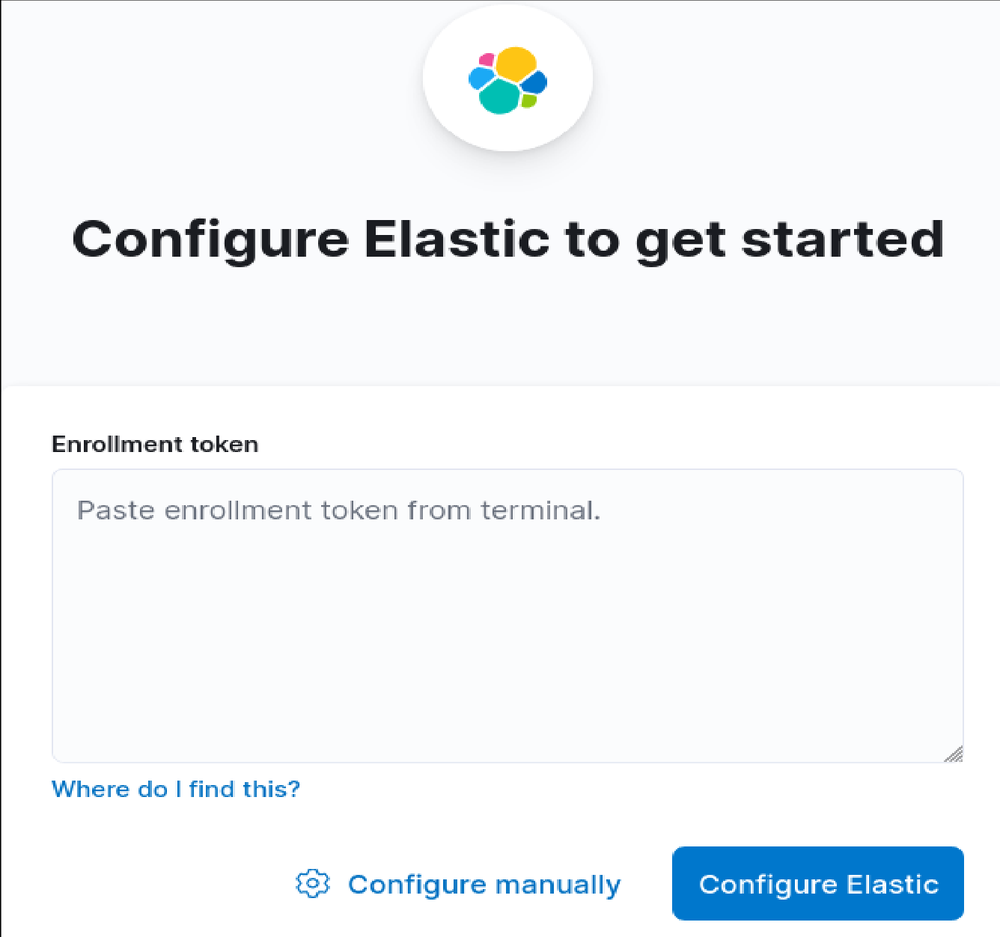<br><em>Figure 13 — Écran de configuration initiale de Kibana (enrollment token)</em></p>

### 6. Installation de Suricata

<p align="center">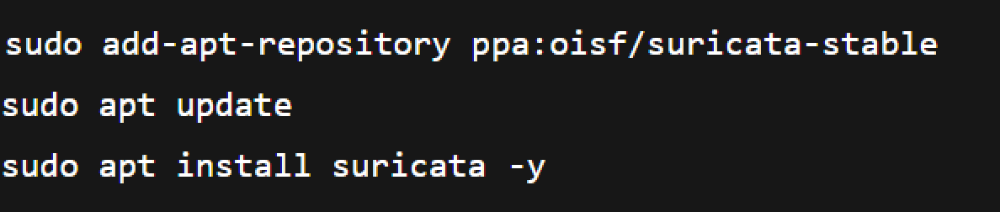<br><em>Figure 14 — Installation de Suricata (PPA officiel)</em></p>

Vérification de l'installation : `suricata --build-info`

**Emplacement des fichiers de configuration Suricata :**

| Fichier / dossier | Contenu |
|---|---|
| `/etc/suricata/suricata.yaml` | Configuration générale |
| `/etc/suricata/rules/` | Règles IDS |
| `/var/log/suricata/` | Journaux générés |

## Règles de détection Suricata

### Détection d'une attaque DDoS

<p align="center">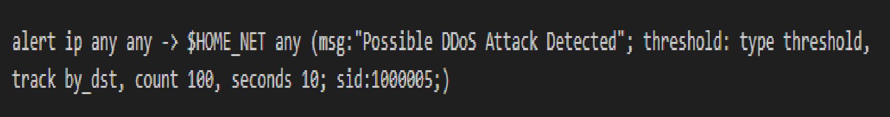<br><em>Figure 15 — Règle de détection d'une attaque DDoS</em></p>

Cette règle déclenche une alerte de priorité 3 lorsqu'elle observe **100 paquets en 10 secondes** vers le réseau protégé (`$HOME_NET`).

### Détection d'une attaque SSH par force brute

<p align="center">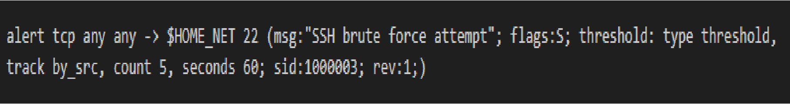<br><em>Figure 21 — Règle de détection de l'attaque par force brute SSH</em></p>

Cette règle déclenche une alerte lorsqu'elle observe **5 tentatives de connexion SYN sur le port 22 en 60 secondes**, en provenance d'une même source.

## Agent de collecte Windows : Winlogbeat

**Winlogbeat** collecte les éléments du journal des événements Windows et les envoie vers le serveur Elasticsearch. Il permet de surveiller :
- l'activité de connexion des utilisateurs,
- les tentatives de connexion infructueuses,
- les comptes bloqués,
- les événements système en général.

<p align="center"><br><em>Figure 16 — Schéma de fonctionnement de Winlogbeat</em></p>

**Étapes de mise en œuvre :**
1. Télécharger Winlogbeat depuis le site officiel Elastic (`elastic.co/downloads/beats/winlogbeat`).
2. Éditer `winlogbeat.yml` pour renseigner l'adresse IP du serveur ELK (hôte Kibana, sortie Elasticsearch, identifiants).
3. Démarrer le service.

<p align="center">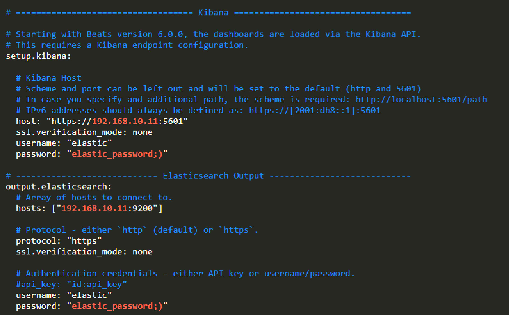<br><em>Figure 17 — Configuration de winlogbeat.yml (hôtes Kibana et Elasticsearch)</em></p>

<p align="center"><br><em>Figure 18 — Démarrage du service Winlogbeat (PowerShell)</em></p>

## Scénarios de test et résultats

Pour chaque attaque, trois objectifs sont évalués : **détection**, **journalisation**, et **notification d'alerte via Telegram**.

### Scénario 1 — Attaque par déni de service (DoS)

L'attaque est lancée depuis la machine Kali avec l'outil **hping3**, qui envoie un flux massif de paquets TCP vers la cible :

<p align="center">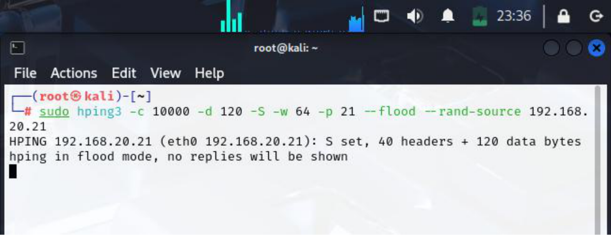<br><em>Figure 19 — Attaque DoS réalisée avec hping3 depuis la machine attaquante</em></p>

```
sudo hping3 -c 10000 -d 120 -S -w 64 -p 21 --flood --rand-source 192.168.20.21
```

Résultat dans le journal Suricata (`/var/log/suricata/fast.log`) :

<p align="center">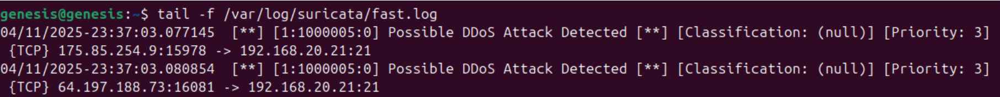<br><em>Journal Suricata : détection horodatée de l'attaque DDoS</em></p>

L'attaque est détectée avec précision à la date et à l'heure de son lancement, confirmant une corrélation immédiate entre l'incident et sa détection.

Une alerte automatique est également reçue sur le bot Telegram :

<p align="center">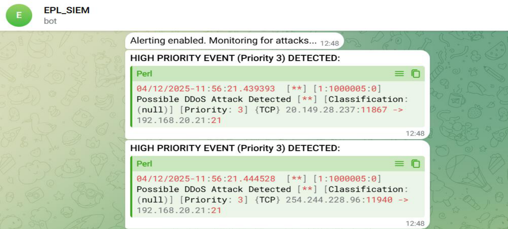<br><em>Figure 20 — Alerte Telegram lors de l'attaque DoS</em></p>

✅ **Détection, journalisation et notification confirmées.**

### Scénario 2 — Attaque SSH par force brute

Attaque réalisée avec **Hydra**, en exploitant la liste de mots de passe `rockyou.txt` :

<p align="center">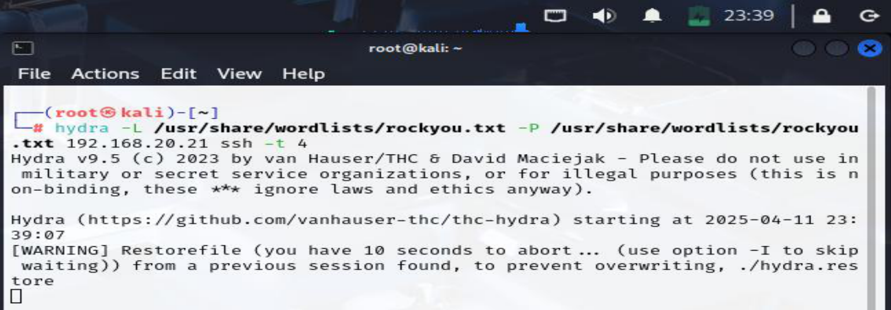<br><em>Figure 22 — Attaque SSH par force brute avec Hydra</em></p>

```
hydra -L /usr/share/wordlists/rockyou.txt -P /usr/share/wordlists/rockyou.txt 192.168.20.21 ssh -t 4
```

Détection confirmée côté serveur (Elasticsearch / Suricata) :

<p align="center">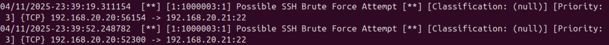<br><em>Figure 23 — Détection de l'attaque SSH brute force</em></p>

Alerte reçue sur Telegram :

<p align="center">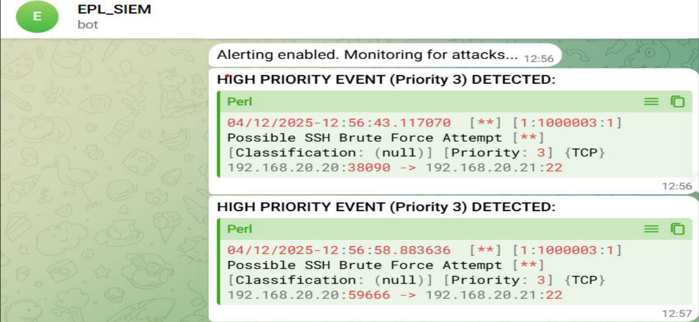<br><em>Figure 24 — Alerte Telegram lors de l'attaque SSH brute force</em></p>

✅ **Détection, journalisation et notification confirmées.**

### Scénario 3 — Authentification illégitime sur un système Windows

Test consistant à tenter une connexion à la session d'un utilisateur (« Genesis ») en saisissant intentionnellement un mot de passe erroné :

<p align="center">


<br><em>Figures 25-26 — Tentative d'authentification illégitime puis rejet du mot de passe</em>
</p>

Le tableau de bord **Winlogbeat** dans Kibana affiche en temps réel la mise à jour du statut des connexions échouées (« Failed Logons ») :

<p align="center">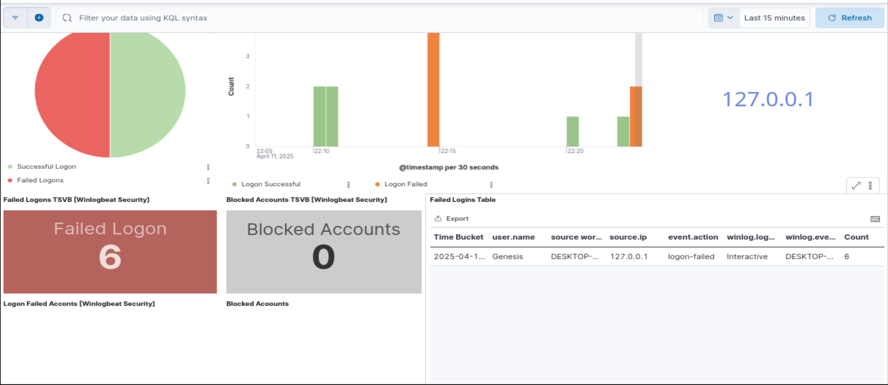<br><em>Figure 27 — Tableau de bord Winlogbeat : connexions échouées</em></p>

Le détail de l'événement, avec l'horodatage et le nom d'utilisateur concerné, est consultable dans la table des connexions échouées :

<p align="center">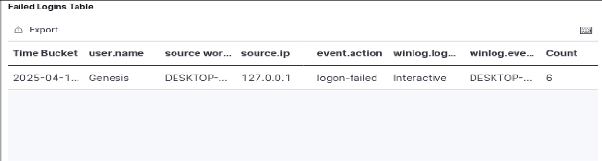<br><em>Figure 28 — Détail de l'échec d'authentification (event.action = logon-failed)</em></p>

✅ **Détection et journalisation confirmées via le Dashboard Winlogbeat.**

## Conclusion

Ce projet a permis de mettre en œuvre et d'évaluer l'efficacité d'une solution SIEM basée sur **ELK Stack + Suricata** dans un environnement de test virtualisé. Les composants essentiels (collecte, normalisation, stockage, visualisation) ont été intégrés et configurés avec succès, et les simulations d'attaques (**DoS**, **SSH brute force**, **authentification illégitime**) ont confirmé la capacité du système à :

- détecter des comportements anormaux en temps réel,
- journaliser précisément les incidents (horodatage, source, type d'attaque),
- générer des alertes pertinentes via Telegram.

Bien qu'open-source et gratuite, cette solution démontre qu'elle peut jouer un rôle essentiel dans une stratégie de cybersécurité, à condition d'être correctement configurée et adaptée au contexte de l'organisation. L'environnement de test étant restreint, le projet est extensible à un réseau de plus grande taille moyennant l'adaptation des configurations et des paramètres.

## Références

1. France 24 — *Elon Musk assure que X (ex-Twitter) subit une cyberattaque massive* — [lien](https://www.france24.com/fr/info-en-continu/20250310-elonmusk-assure-que-x-ex-twitter-subit-une-cyberattaque-massive-1) (consulté le 17/03/2025)
2. Vidéo de référence sur la conformité réglementaire (ISO 27001, PCI-DSS, RGPD) — [lien](https://youtu.be/Ero6zPCI_pk)
3. *Étude et mise en place d'un SIEM open-source* — MemoireOnline — [lien](https://www.memoireonline.com/07/21/11983/Etude-et-mise-en-place-dun-SIEM-security-information-and-event-management-open-source-cas-de-.html)

---

*Documentation générée à partir du rapport de projet tuteuré INF 1522 — École Polytechnique de Lomé.*
